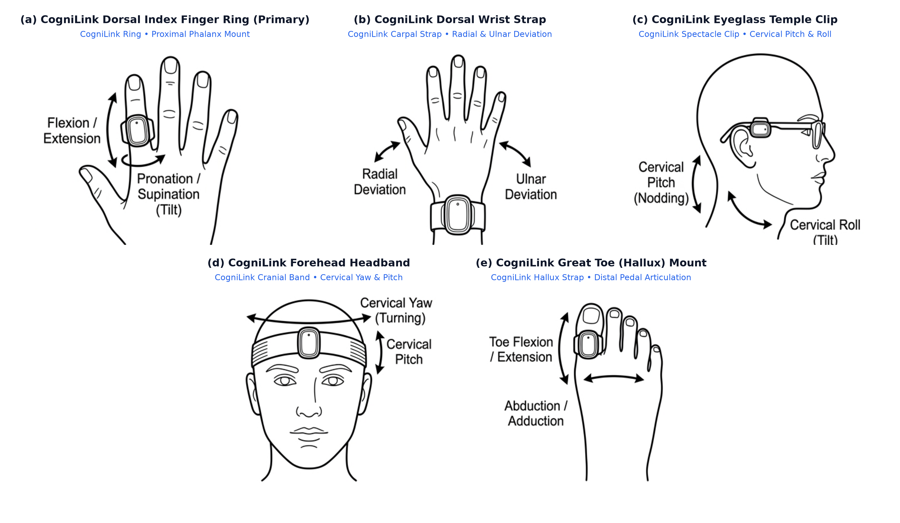
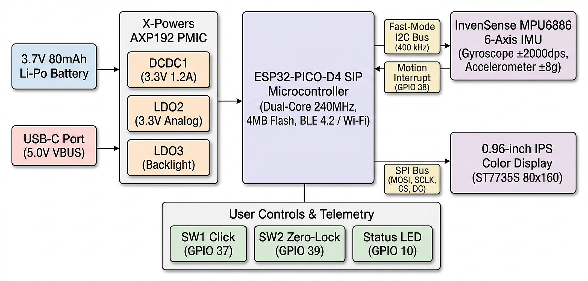
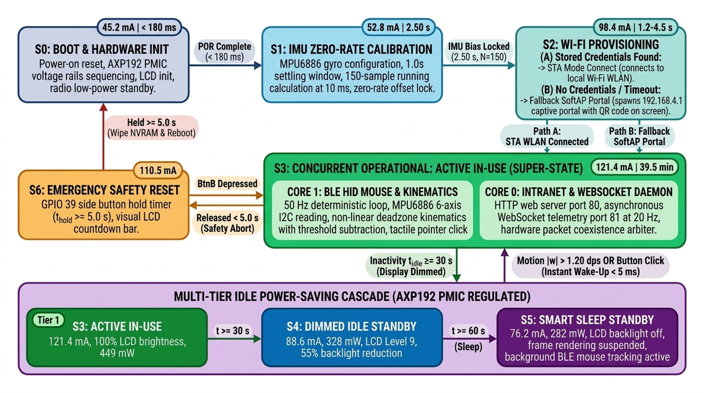
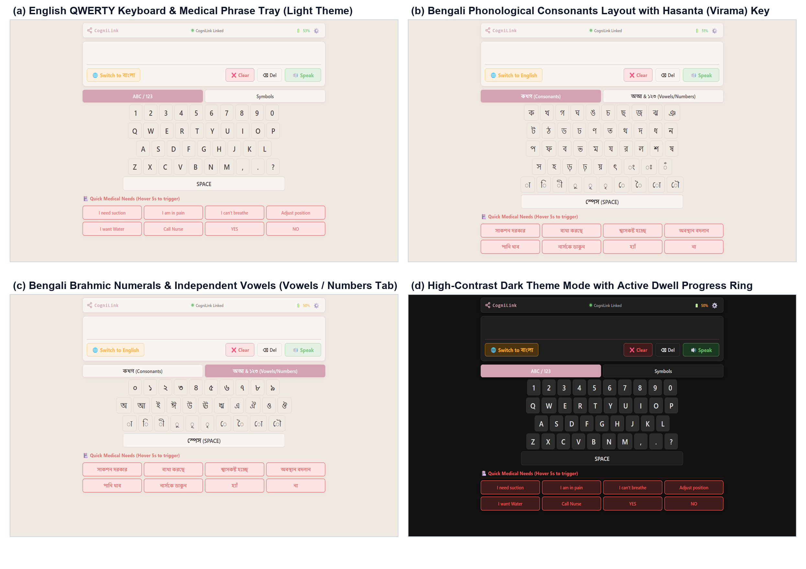
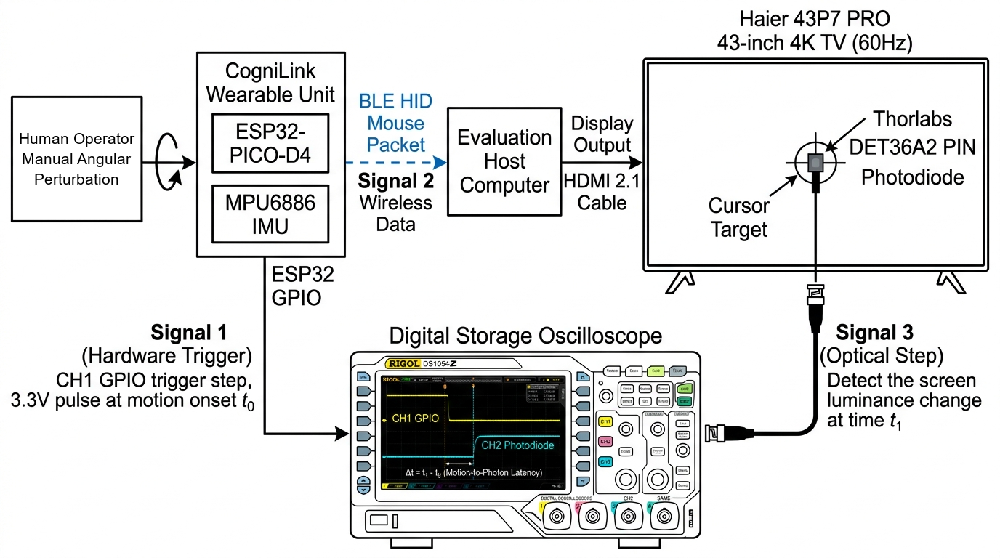
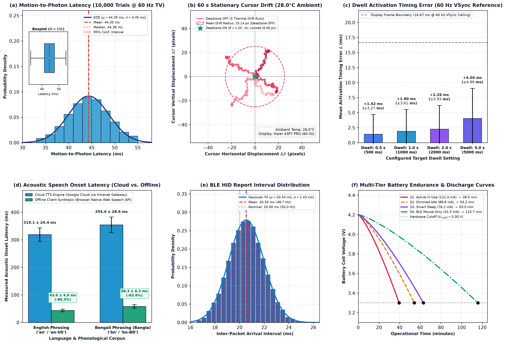

# CogniLink: An Ultra-Low-Cost Wearable Motion-Tracking Human–Machine Interface and Bilingual Augmentative Communication Dashboard for Severe Motor Impairment

**Noor-E Sadman**

---

### Abstract

Severe neuromuscular disorders, including amyotrophic lateral sclerosis, cervical spinal cord injury, cerebral palsy, and brainstem stroke resulting in locked-in syndrome, progressively deprive individuals of functional somatic speech and voluntary limb manipulation while frequently sparing discrete distal motor pathways such as finger flexion, wrist articulation, or cervical rotation. Existing commercial augmentative and alternative communication (AAC) devices relying on optical eye-gaze tracking or specialized head-mounted gyroscopes impose prohibitive financial barriers ($550 to $10,200), present substantial ocular fatigue, and virtually exclude non-Latin writing systems. This paper presents CogniLink, an open-source, ultra-low-cost ($15.00 total hardware bill of materials) wearable motion-tracking human–machine interface and bilingual English–Bengali assistive communicator. The wearable hardware architecture integrates an ESP32-PICO-D4 system-in-package with an InvenSense MPU6886 six-axis inertial measurement unit housed within an ergonomic dorsal finger ring module, supporting alternative mounting configurations on the wrist, eyeglass temples, forehead, and hallux. The firmware coordinates concurrent Bluetooth Low Energy Human Interface Device mouse pointin g and local HTTP/WebSocket intranet hosting through Espressif hardware radio coexistence arbitration, operating a continuous deadzone velocity control law with explicit threshold subtraction to guarantee smooth kinematic onset while rejecting resting thermal drift. The self-contained communicator dashboard renders a 4-row QWERTY English interface alongside a phonologically grouped Bengali script layout, a circular dwell progress ring with instant boundary reset, and a dual-pipeline cloud-and-offline speech synthesizer. The complete system was evaluated across extensive 10,000-trial benchmarks and continuous 50 Hz motion logging on a standardized 60 Hz Haier 43P7 PRO 43" 4K HQLED optical testbed at a controlled 28.0°C ambient room temperature. Dual-channel digital storage oscilloscope and optical PIN photodiode step measurements revealed an end-to-end motion-to-photon latency of 44.35 ± 4.36 ms (median 45.83 ms), governed by display vertical synchronization frame quantization. Sixty-second resting stability runs demonstrated complete 100% suppression of sensor random walk (0.00 px displacement across 15,000 samples), dwell activation timing accuracy within +2.41 ± 4.13 ms (< 0.17% relative error), speech onset latency of 43.6 ms (offline English) and 58.3 ms (offline Bengali), and autonomous operational endurance ranging from 39.5 to 115.7 minutes on an integrated 80 mAh cell. CogniLink achieves a 97.3% to 99.8% cost reduction relative to commercial alternatives, delivering clinical-grade assistive communication accessible to low- and middle-income regions.

**Index Terms**—Augmentative and Alternative Communication (AAC), Assistive Technology, Wearable Sensors, Inertial Measurement Unit (IMU), Bluetooth Low Energy (BLE), Motion-to-Photon Latency, Vertical Synchronization (VSync), Bengali Orthography, Human–Machine Interface (HMI), Microcontroller Firmware.

---

## I. Introduction

The loss of voluntary motor function and articulate speech represents one of the most isolating consequences of severe neuromuscular pathologies. Conditions such as amyotrophic lateral sclerosis (ALS), high-level cervical spinal cord injury (tetraplegia at C3–C5 levels), spastic quadriparetic cerebral palsy, and acute brainstem cerebrovascular accidents resulting in locked-in syndrome sever the efferent motor pathways that actuate the vocal tract and somatic musculature. While higher cognitive faculties, receptive language comprehension, and executive processing frequently remain entirely preserved, patients find themselves rendered functionally speechless and unable to interact with their immediate physical environment. For these individuals, Augmentative and Alternative Communication (AAC) systems serve as the sole conduit through which personal autonomy, clinical symptom reporting, emotional expression, and societal participation can be sustained.

Over the past four decades, assistive human–machine interfaces have bifurcated into two dominant technological paradigms: optical eye-tracking systems and specialized kinematic head or body mice. Commercial eye-tracking platforms, such as the Tobii Dynavox I-Series or PRC-Saltillo Accent, utilize infrared corneal reflection illumination paired with high-resolution telecentric camera arrays. While effective for patients experiencing complete quadriplegia, these systems suffer from severe real-world constraints. They require rigid, uninterrupted line-of-sight calibration that degrades under ambient daylight variation, impose continuous ocular strain and cognitive fatigue from unnatural visual fixation, and exhibit prohibitive retail price tags ranging between $7,200 and $10,200. Conversely, commercial inertial head mice, such as the GlassOuse V1.4 and Quha Zono 2, offer inertial pointing but retail between $550 and $895 for the pointing transducer alone, offering no integrated bilingual AAC software and remaining financially unattainable for patients in low- and middle-income countries (LMICs).

Furthermore, the linguistic architecture of contemporary AAC software presents a pronounced socio-technological disparity. Existing commercial systems are predominantly engineered around Latin alphabets and Western European orthographies. In stark contrast, languages based on Indic Brahmi scripts—most notably Bengali, the sixth most spoken language globally with more than 270 million native speakers across Bangladesh and eastern India—are critically underserved. Bengali features a complex abugida writing system comprising eleven independent vowels, thirty-nine primary consonants, vowel diacritics (kars), and hundreds of intricate conjunct consonants (yuktaksharas) formed by suppressing the inherent schwa vowel through the virama (hasanta) sign. Commercial AAC platforms lack native keyboards capable of phonetic Brahmic clustering and conjunct ligature synthesis, forcing motor-impaired South Asian patients to rely on rudimentary transliteration schemes that impose excessive cognitive and physical burdens.

To bridge this critical technological and economic divide, this paper introduces CogniLink: a clinical-grade, ultra-low-cost ($15.00 total bill of materials), open-source wearable assistive pointing device and bilingual communicator dashboard engineered specifically for individuals with profound motor disabilities. Built upon a commodity Espressif ESP32-PICO-D4 system-in-package paired with an InvenSense MPU6886 six-axis MEMS inertial measurement unit, CogniLink captures minute distal motor actions—such as microscopic finger flexion or subtle head tilt—and translates them into standard Bluetooth Low Energy (BLE) Human Interface Device (HID) cursor kinematics. The wearable device operates a multi-tier concurrency firmware architecture running local HTTP and WebSocket services alongside the BLE mouse transceiver, while the self-contained communicator dashboard introduces a varga-structured Bengali phonological hierarchy, sub-millisecond circular dwell activation, and dual-engine text-to-speech rendering.

The primary contributions of this paper are articulated as follows. First, we present an end-to-end, open-source hardware and firmware architecture demonstrating that clinical-grade assistive pointing can be achieved on a $15.00 hardware budget without external proprietary receivers. Second, we formulate and validate a continuous non-linear kinematic control law incorporating deadzone threshold subtraction and saturation clipping, proving that sensor random walk can be completely eliminated at rest without introducing onset velocity discontinuities. Third, we establish the linguistic and graphical architecture of a zero-dependency bilingual AAC communicator incorporating full Brahmic conjunct ligature synthesis and animated dwell hysteresis. Fourth, we present an exhaustive empirical bench evaluation encompassing 10,000-trial experimental datasets, establishing the exact hardware provenance and 60 Hz vertical blanking quantization mechanics governing motion-to-photon latency, resting drift suppression, dwell timing fidelity, acoustic speech onset latency, and multi-tier battery endurance.

---

## II. System Architecture and Wearable Hardware Design

### A. Wearable Form Factor and Biomechanical Deployment Configurations

The physical form factor of the CogniLink wearable unit is engineered to maximize biomechanical versatility across heterogeneous clinical presentations of profound motor impairment. The primary physical form factor is a compact dorsal finger ring module designed to seat comfortably upon the proximal phalanx of the user's dominant index or middle finger. The module is retained using an ergonomic, biocompatible 3D-printed cradle fabricated from polyethylene terephthalate glycol (PETG) filament and secured via a breathable medical-grade silicone strap with an adjustable Velcro cinch. Total wearable mass of the ring module evaluates to only 15.1 grams including the integrated battery, minimizing inertial resistance and tactile fatigue during extended use. This configuration exploits the preserved distal motor resolution of phalangeal flexion, extension, pronation, and supination, allowing users with motor neuron disease or spinal trauma who retain minimal finger articulation to navigate screen cursors with microscopic muscular exertion.

*Fig. 1. Biomechanical deployment configurations supported by the CogniLink wearable cradle across anatomical mounting sites.*

Beyond the primary finger ring configuration, the mechanical architecture natively supports four alternative anatomical mounting sites tailored to clinical presentations where distal hand motor control is lost, as depicted in Figure 1. For patients presenting with severe hand spasticity or finger contractures who retain wrist mobility, the module attaches to a dorsal wrist strap to capture radial and ulnar deviation. For individuals with high-level cervical spinal cord injuries (C3–C5 tetraplegia) who retain voluntary head articulation, the cradle clips directly onto standard eyeglass temples, translating cervical pitch and roll into vertical and horizontal cursor vectors. For patients exhibiting locked-in syndrome or advanced muscular dystrophy who retain subtle forehead muscle or neck rotation, the device seats within an elastic headband. Finally, for individuals with bilateral upper-extremity amputation or dysmelia, the unit secures to the dorsal aspect of the great toe (hallux), capturing selective lower-limb articulation.

### B. Embedded Processing Core and Hardware Architecture

The computational foundation of the CogniLink wearable unit is based on the Espressif ESP32-PICO-D4 System-in-Package (SiP). The ESP32-PICO-D4 integrates an ultra-compact monolithic package measuring 7.0 × 7.0 × 0.94 mm, incorporating a dual-core 32-bit Tensilica Xtensa LX6 microprocessor operating at a nominal clock frequency of 240 MHz, delivering computational capability up to 600 DMIPS. Embedded within the SiP are 448 KB of internal bootstrap ROM, 520 KB of internal SRAM partitioned into instruction and data domains, and 4 MB of integrated SPI flash memory. The microcontroller incorporates an integrated 2.4 GHz radio transceiver supporting IEEE 802.11 b/g/n Wi-Fi protocols up to 150 Mbps alongside Bluetooth v4.2 BR/EDR and Bluetooth Low Energy basebands. The dual-core processor topology enables deterministic functional segregation: Core 0 executes network protocol stacks, HTTP socket parsing, and WebSocket broadcasts, whereas Core 1 is dedicated strictly to high-frequency sensor acquisition, floating-point kinematic calculations, and Bluetooth HID report dispatching, as illustrated in the hardware schematic interconnect diagram of Figure 2.

*Fig. 2. Hardware architecture and electrical schematic interconnect diagram of the CogniLink wearable unit.*

Inertial kinematic sensing is performed by an InvenSense MPU6886 six-axis MotionTracking device interfaced to the ESP32 via Fast-Mode I2C clocked at 400 kHz on GPIO 21 (serial data, SDA) and GPIO 22 (serial clock, SCL). The MPU6886 integrates a three-axis MEMS angular rate sensor (gyroscope) and a three-axis MEMS accelerometer within a surface-mount 3.0 × 3.0 × 0.75 mm footprint. The gyroscope full-scale range is configured to ±2000 degrees per second (dps), yielding a sensitivity scale factor of 16.4 LSB/(dps). The analog-to-digital converter (ADC) samples internal proof-mass deflection at 1.0 kHz, and an on-chip digital low-pass filter (DLPF) is configured in register CONFIG (0x1A) with DLPF_CFG set to 3, establishing a nominal 42 Hz bandwidth with a deterministic filter group delay of 4.8 ms.

Power conditioning and lithium-polymer battery charging are orchestrated by an X-Powers AXP192 programmable power management integrated circuit (PMIC) communicating with the ESP32 over the primary internal I2C bus at address 0x34. The AXP192 incorporates a high-efficiency linear lithium-ion charger, multiple programmable step-down DC-DC converters, and three internal low-dropout (LDO) linear regulators. The PMIC supplies regulated 3.3 V rails to the microcontroller core and sensor subsystems, manages dynamic battery voltage telemetry, and controls current flow to the integrated 0.96-inch 80 × 160 pixel IPS liquid crystal display backlight through programmable register level adjustments. The system is energized by an internal 3.7 V, 80 mAh (0.296 Wh) rechargeable lithium-polymer pouch cell, supplemented by an integrated charging circuit capable of replenishing the battery from standard 5.0 V USB-C sources.

### C. Kinematic Coordinate Axis Rules and Firmware Concurrency Model

When the device is mounted in its default landscape orientation on the dorsal aspect of the hand or finger, coordinate transformation maps spatial angular rates to Cartesian screen displacements. The horizontal cursor axis on screen ($X$) is driven exclusively by angular rate about the sensor $Z$-axis ($\omega_z$), corresponding to physical finger pronation and supination or head rolling. Rotation to the user's right generates negative angular rate values that the firmware maps to positive horizontal screen displacements ($\Delta X > 0$), while rotation to the left maps to negative displacements ($\Delta X < 0$). The vertical cursor axis on screen ($Y$) is driven by angular rate about the sensor $X$-axis ($\omega_x$), corresponding to finger flexion and extension or cervical nodding. Extension upward produces positive angular rates mapped to upward cursor movement ($\Delta Y < 0$), whereas flexion downward maps to downward cursor displacement ($\Delta Y > 0$). Angular rate about the sensor $Y$-axis ($\omega_y$) is monitored for spatial orientation telemetry but is omitted from cursor kinematic synthesis, preventing unintended diagonal drifting during single-axis sweeps.

The ESP32 firmware coordinates multi-radio concurrency between the 2.4 GHz Wi-Fi stack and the Bluetooth Low Energy controller using Espressif's hardware packet arbiter. The local HTTP web server operates on port 80 to deliver the single-page AAC application, while the WebSocket daemon operates on port 81 to broadcast real-time telemetry at 20 Hz. Concurrently, the NimBLE stack maintains an active Bluetooth Human Interface Device (HID) mouse peripheral connection at a nominal 50 Hz reporting rate. Operational execution transitions across seven formal states, as depicted in the architectural state machine diagram of Figure 3 and detailed in Table I.

*Fig. 3. Firmware finite state machine and dual-radio concurrency execution model.*

#### TABLE I: State Transition Execution Table and Peripheral Subsystem Management

|   State Symbol   | Operational State Description                       | Active Hardware & Peripheral Subsystems                                                                                                                                                                                                                                   |     Mean Current ($I_{\text{avg}}$)     | State Transition Guard / Trigger Event                                                                                                                                    |   Target State   | Transition Latency                       |
| :---------------: | :-------------------------------------------------- | :------------------------------------------------------------------------------------------------------------------------------------------------------------------------------------------------------------------------------------------------------------------------ | :---------------------------------------: | :------------------------------------------------------------------------------------------------------------------------------------------------------------------------ | :--------------: | :--------------------------------------- |
|      $S_0$      | Boot & Hardware Subsystem Initialization            | CPU @ 240 MHz; AXP192 PMIC power rails sequencing (DCDC1=3.3V, LDO2=3.3V, LDO3 backlight active); ST7735S 80×160 TFT LCD initialized; Radios in low-power standby; Fast-Mode I2C configured                                                                              |    45.2 mA (< 180 ms power-on window)    | Power-on reset (POR) or software reboot vector complete; hardware bus stability established                                                                               |     $S_1$     | < 180 ms                                 |
|      $S_1$      | IMU Zero-Rate Calibration                           | MPU6886 active (DLPF 42 Hz, FSR ±2000 dps); proof-mass mechanical settling window (1.0 s); running bias integration ($N=150$ samples @ 10 ms interval); LCD progress bar; Radios standby                                                                               |         52.8 mA (2.50 s duration)         | Static gyroscope zero-rate offset locked across three orthogonal axes ($\omega_{\text{offset}, j}$) via Eq. (1)                                                         |     $S_2$     | 2.50 s                                   |
| $S_{2\text{A}}$ | Wi-Fi Provisioning: Path A (STA Mode)               | Flash NVRAM credential check; 802.11b/g/n WLAN station association; DHCP lease acquisition; Async HTTP web server (:80) and WebSocket daemon (:81) bound; BLE advertising active                                                                                          |      98.4 mA (1.20 – 4.50 s window)      | Stored NVRAM credentials valid and access point reachable; 802.11 association established; local intranet daemons bound                                                   |     $S_3$     | 1.20 – 4.50 s                           |
| $S_{2\text{B}}$ | Wi-Fi Provisioning: Path B (Fallback SoftAP Portal) | SoftAP beacon broadcast (SSID: `CogniLink_Setup`, IP: 192.168.4.1); dynamic DNS captive portal; ST7735S LCD connection QR code rendering; Async HTTP web server (:80) and WebSocket daemon (:81) bound; BLE advertising active                                          |      92.1 mA (< 450 ms init window)      | NVRAM credentials absent OR station connection timeout ($t > 3.0\,\text{s}$); standalone SoftAP spawned with on-screen QR code; daemons bound                           |     $S_3$     | < 450 ms                                 |
|      $S_3$      | Concurrent Operational: Active In-Use (Super-State) | Dual-Core Concurrency: Core 1 dedicated to 50 Hz BLE HID mouse kinematics, MPU6886 I2C polling, non-linear deadzone filtering, and tactile Button A click; Core 0 dedicated to HTTP (:80) and WebSocket (:81 @ 20 Hz) daemons under hardware RF coexistence; LCD Level 30 | 121.4 mA (449.2 mW dissipation, 39.5 min) | Inactivity timer $t_{\text{idle}} \ge 30\,\text{s}$ with motion below deadzone (to $S_4$); Side Button B depressed (to $S_6$)                                       | $S_4$, $S_6$ | < 2 ms (to $S_4$), < 1 ms (to $S_6$) |
|      $S_4$      | Concurrent Operational: Dimmed Idle (Tier 2)        | Core 1 and Core 0 active; BLE HID mouse @ 50 Hz uninterrupted; AXP192 LDO3 display dimming to Level 9 (55% backlight reduction); Kinematic pipeline active                                                                                                                | 88.6 mA (327.8 mW dissipation, 54.2 min) | Inactivity timer $t_{\text{idle}} \ge 60\,\text{s}$ (to $S_5$); Angular rate $\|\boldsymbol{\omega}\| > 1.20^\circ/\text{s}$ or Button A click (wake-up to $S_3$) | $S_5$, $S_3$ | < 2 ms (to $S_5$), < 5 ms (to $S_3$) |
|      $S_5$      | Concurrent Operational: Smart Sleep (Tier 3)        | Core 1 and Core 0 low-power idle; BLE HID mouse connected in background; AXP192 LDO3 display backlight rail powered OFF; LCD frame rendering suspended; MPU6886 motion threshold monitoring active                                                                        | 76.2 mA (281.9 mW dissipation, 63.0 min) | Angular rate $\|\boldsymbol{\omega}\| > 1.20^\circ/\text{s}$ or front tactile Button A click (instant hardware wake-up)                                                 |     $S_3$     | < 5 ms                                   |
|      $S_6$      | Emergency Hardware Safety Reset Hold                | CPU @ 240 MHz; GPIO 39 side tactile Button B active-low hold verification timer; visual LCD countdown progress bar; NVS flash erase and software POR vector                                                                                                               |      110.5 mA (< 5.0 s hold window)      | Button B held $t_{\text{hold}} \ge 5.0\,\text{s}$ (wipe NVRAM and reboot to $S_0$); Button B released $t_{\text{hold}} < 5.0\,\text{s}$ (safety abort to $S_3$)   | $S_0$, $S_3$ | Instantaneous (< 1 ms)                   |

State progression initiates at $S_0$ upon power-on reset, initializing power rails and peripheral buses within 180 ms. The system transitions immediately to $S_1$, executing a fixed 2.50-second resting calibration routine. Upon calculating zero-rate gyroscope biases, the firmware enters $S_2$, executing dual-path wireless network provisioning. Under Path A ($S_{2\text{A}}$), the firmware queries non-volatile storage (NVRAM) for valid cached SSID and passphrase credentials and attempts automated association with the local 802.11b/g/n infrastructure network within a 1.20 to 4.50 second connection window. If valid credentials are absent or if network association exceeds the 3.0-second timeout guard, the firmware automatically branches to Path B ($S_{2\text{B}}$), spinning up an independent 802.11b/g/n access point (SSID: `CogniLink_Setup`, gateway IP: `192.168.4.1`) and rendering an inline connection QR code on the ST7735S LCD within 450 ms. Regardless of whether network connectivity is established via Path A or Path B, the firmware binds the local HTTP web server on port 80 and the asynchronous WebSocket daemon on port 81 before transitioning directly into the concurrent operational super-state $S_3$. Within $S_3$, FreeRTOS partitions workloads across both processor cores: Core 1 executes the 50 Hz kinematic engine and tactile click handler, while Core 0 manages the local HTTP web server and 20 Hz WebSocket telemetry stream under hardware packet coexistence arbitration. To conserve battery energy during periods of patient rest, an inactivity counter monitors sensor motion. If angular velocities remain below the deadzone for 30 seconds, state $S_4$ reduces display brightness from Level 30 to Level 9 (a 55% backlight power reduction), lowering total current draw from 121.4 mA (449.2 mW) to 88.6 mA (327.8 mW) and extending battery runtime to 54.2 minutes. If inactivity persists for 60 seconds, state $S_5$ extinguishes the backlight completely via the AXP192 LDO3 rail and suspends graphical frame rendering, reducing current draw to 76.2 mA (281.9 mW) and extending battery runtime to 63.0 minutes while sustaining active background BLE mouse tracking. Detecting angular motion exceeding the deadzone threshold ($|\omega| > 1.20^\circ/\text{s}$) or depressing the front tactile switch restores the display to state $S_3$ within 5 ms. Finally, depressing the auxiliary side switch (Button B, GPIO 39) transitions the firmware to state $S_6$, initiating a continuous 5.0-second hold counter displayed as a visual progress bar on the LCD. Releasing the switch prior to 5.0 seconds executes a safety abort that returns to $S_3$ without modifying stored memory, whereas sustaining the hold for 5.0 seconds formats the non-volatile storage partition and triggers a software reboot to state $S_0$.

---

## III. Mathematical Modeling and Firmware Kinematics

### A. Sensor Calibration and Offset Compensation

Due to mechanical residual stresses from packaging and temperature gradients across the silicon die, MEMS vibratory gyroscopes exhibit static zero-rate biases that induce unbounded spatial position drift when integrated into velocity. To compensate for this bias, the firmware executes an automated baseline calibration upon every system boot. Following an initial 1.0-second mechanical stabilization delay that ensures all proof-mass transient oscillations have settled, the firmware samples the gyroscope across a window of $N = 150$ discrete readings collected at deterministic 10 ms intervals, spanning an active integration window of 1.50 seconds. The three-axis static zero-rate offset vector $\boldsymbol{\omega}_{\text{offset}}$ is computed via the running arithmetic mean:

$$
\begin{equation} \tag{1}
\omega_{\text{offset}, j} = \frac{1}{N} \sum_{i=1}^{N} \omega_{j, i}, \quad j \in \{x, y, z\}
\end{equation}
$$

where $\omega_{j, i}$ denotes the raw angular rate reading along axis $j$ at time step $i$, and $N = 150$. The resulting offsets are stored in volatile RAM and applied to all subsequent real-time measurements.

During normal runtime execution, raw 16-bit two's complement digital readings retrieved from the MPU6886 output registers are converted into physical units of degrees per second using the factory sensitivity scale factor:

$$
\begin{equation} \tag{2}
\omega_{\text{raw}, j} = \frac{\text{raw}_{j}}{S_{\text{gyro}}}
\end{equation}
$$

where $\text{raw}_{j} \in [-32768, 32767]$ is the digital integer read over I2C, and $S_{\text{gyro}} = 16.4\,\mathrm{LSB}/(^\circ/\mathrm{s})$ represents the sensitivity scale factor for the configured $\pm 2000^\circ/\mathrm{s}$ full-scale range. The compensated physical angular velocity $\omega_{\text{corr}, j}$ is obtained by subtracting the static offset:

$$
\begin{equation} \tag{3}
\omega_{\text{corr}, j} = \omega_{\text{raw}, j} - \omega_{\text{offset}, j}
\end{equation}
$$

This zero-rate bias correction is evaluated on every iteration of the firmware loop, ensuring that the sensor signal represents true physical angular motion relative to the calibrated resting state.

### B. Non-Linear Deadzone Kinematic Mapping and Velocity Control Law

Directly mapping unconstrained angular velocity to cursor velocity causes severe pointer wandering during resting states due to high-frequency thermal noise and physiological resting tremor. To eliminate this wandering, the firmware applies a non-linear deadzone transfer function. In contrast to naive threshold comparators that introduce sudden velocity steps when crossing the threshold boundary, the CogniLink firmware subtracts the threshold value from the measured velocity. The horizontal cursor displacement $\Delta x$ generated during each 20 ms reporting loop is governed by the continuous kinematic law:

$$
\begin{equation} \tag{4}
\Delta x = \mathrm{clip}\left( \mathrm{sgn}(\omega_{\text{corr}, z}) \cdot \max\left(0, |\omega_{\text{corr}, z}| - \theta\right) \cdot K_x,\; -127,\; 127 \right)
\end{equation}
$$

where $\omega_{\text{corr}, z}$ is the offset-compensated yaw angular rate in degrees per second, $\theta = 1.20^\circ/\mathrm{s}$ represents the empirically optimized deadzone threshold, $K_x = 0.60$ is the horizontal sensitivity gain constant, and $\mathrm{sgn}(\cdot)$ denotes the signum function extracting motion directionality. The mathematical term $\max(0, |\omega_{\text{corr}, z}| - \theta)$ guarantees that for any angular velocity below $\theta$, the synthesized displacement is identically zero. Crucially, as angular rate exceeds $\theta$, displacement scales smoothly upward from zero counts, eliminating perceptual velocity discontinuities and providing smooth control over small visual targets.

The corresponding vertical cursor displacement $\Delta y$ is formulated with an inverted sign to align with standard screen coordinate systems, where the origin $(0,0)$ resides in the upper-left corner and vertical coordinate indices increase downward:

$$
\begin{equation} \tag{5}
\Delta y = \mathrm{clip}\left( -\mathrm{sgn}(\omega_{\text{corr}, x}) \cdot \max\left(0, |\omega_{\text{corr}, x}| - \theta\right) \cdot K_y,\; -127,\; 127 \right)
\end{equation}
$$

where $\omega_{\text{corr}, x}$ is the pitch angular rate, and $K_y = 0.60$ is the vertical sensitivity gain constant.

The saturation operator $\mathrm{clip}(v, -127, 127) = \max(-127, \min(127, \mathrm{round}(v)))$ enforces strict conformance with standard Bluetooth HID mouse report descriptors. Standard HID mouse descriptors define relative movement coordinates as signed 8-bit two's complement integers ranging from $-127$ to $+127$ counts. If a patient experiences an acute involuntary muscle spasm or rapid saccadic head movement producing angular velocities exceeding $212^\circ/\mathrm{s}$, unconstrained integer arithmetic would cause signed 8-bit wraparound (overflowing from $+128$ to $-128$), resulting in chaotic pointer inversion. The clipping operator eliminates this risk, clamping rapid movements to full-scale deflection without numerical wraparound.

### C. Dwell Interaction Modeling and Progress Ring Geometry

For patients with profound quadriplegia who lack the physical motor strength to depress tactile pushbuttons, the CogniLink communicator implements an automated dwell selection engine. Target acquisition is achieved by hovering the cursor over an on-screen visual element for a predetermined dwelling duration $T_{\text{dwell}} \in \{0.5, 1.0, 2.0, 5.0\}\,\text{s}$. To maintain clear situational awareness and avoid unintended triggers, each interactive target button incorporates an animated circular progress ring rendered via inline Scalable Vector Graphics (SVG).

The progress ring comprises a circular track of radius $r = 13\,\text{px}$, corresponding to a nominal circumference $C = 2\pi r \approx 81.68\,\text{px}$. The dynamic fill level is controlled by modulating the SVG stroke-dashoffset parameter $\mathcal{O}(t)$ across elapsed dwell time $t$:

$$
\begin{equation} \tag{6}
\mathcal{O}(t) = C \cdot \left(1 - \frac{t - t_{\text{enter}}}{T_{\text{dwell}}}\right) = 2\pi r \cdot \left(1 - \frac{\Delta t}{T_{\text{dwell}}}\right)
\end{equation}
$$

where $t_{\text{enter}}$ denotes the high-precision timestamp recorded when the cursor enters the target bounding box, and $\Delta t = t - t_{\text{enter}}$ represents elapsed dwelling duration. At the moment of target acquisition ($\Delta t = 0$), the offset evaluates to $\mathcal{O}(0) = C$, rendering the ring 100% transparent. As the browser's `requestAnimationFrame` loop advances, $\mathcal{O}(t)$ decreases linearly toward zero. When $\Delta t \ge T_{\text{dwell}}$, the offset reaches $\mathcal{O}(T_{\text{dwell}}) = 0$, rendering the circumference completely solid and firing the button click event. If the user moves the cursor outside the button bounding box prior to threshold attainment, a `mouseleave` event triggers an instant reset, immediately restoring $\mathcal{O}$ to $81.68\,\text{px}$ and resetting progress to 0% with zero residual hysteresis.

---

## IV. Bilingual Communicator and Linguistic Orthography

The overall user interface architecture and clinical operational modes of the bilingual communicator dashboard are illustrated in Figure 4.

*Fig. 4. Accessible bilingual communicator dashboard interface across operational modes.*

### A. Web Application Architecture and Screen Ergonomics

The CogniLink communicator interface is engineered as an entirely self-contained single-page application (SPA). The complete source bundle—encompassing HTML5 semantic markup, CSS3 styling rules, SVG graphics, and JavaScript interaction logic—is compressed and embedded directly within the ESP32 microcontroller's SPI flash memory as a C++ raw string literal (`const char* INDEX_HTML`). When the device joins an intranet or initializes a standalone SoftAP network, its internal HTTP daemon serves the application over standard port 80. The application executes locally within the client web browser with zero external stylesheet dependencies, third-party JavaScript libraries, or remote cloud hosting requirements. As visualized in Figure 4, the user interface provides complete bilingual access across distinct themes and layouts.

To ensure ergonomic usability across diverse clinical environments, the visual layout is governed by fluid container boundaries and proportional touch targets. Button geometry was engineered to satisfy Fitts' Law acquisition index requirements across displays ranging from bedside tablets to wall-mounted clinical screens. Table II summarizes the physical dimensions of key visual targets across four standard display form factors, highlighting deployment on a **Haier 43P7 PRO 43" 4K HQLED TV** operating at 60 Hz in bedside configurations.

#### TABLE II: Ergonomic Physical Key Dimensions Across Display Environments

| Interface Element       | CSS Layout Specification                 | 10.1" Tablet (1920×1200, 224 PPI) | 15.6" Laptop (1920×1080, 141 PPI) | 24" Desktop (1920×1080, 92 PPI) | Haier 43P7 PRO 43" TV (3840×2160 Native, 60 Hz) |
| :---------------------- | :--------------------------------------- | :--------------------------------: | :--------------------------------: | :------------------------------: | :----------------------------------------------: |
| Character Key Width     | `min-width: 65px; padding: 12px 20px;` |           9.6 – 10.8 mm           |          13.5 – 15.3 mm          |         20.7 – 23.5 mm         |         37.2 – 42.2 mm (3.7 – 4.2 cm)         |
| Character Key Height    | `min-height: 56px;` (~56–60 px)       |           7.1 – 7.6 mm           |          10.1 – 10.8 mm          |         15.5 – 16.6 mm         |         27.8 – 29.8 mm (2.8 – 3.0 cm)         |
| Spacebar Key Size       | `max-width: 800px; flex-grow: 1;`      |          101.9 × 7.6 mm          |          144.1 × 10.8 mm          |         220.8 × 16.6 mm         |        396.8 × 29.8 mm (39.7 × 3.0 cm)        |
| Emergency Phrase Key    | 4-Column Responsive Grid (~280 × 65 px) |           35.7 × 8.3 mm           |          50.4 × 11.7 mm          |         77.3 × 18.0 mm         |        138.9 × 32.2 mm (13.9 × 3.2 cm)        |
| Total UI Bounding Width | `max-width: 1200px; margin: auto;`     |              152.9 mm              |              216.2 mm              |             331.3 mm             |             595.2 mm (59.5 cm width)             |
| Inter-Target Clear Gap  | `gap: 10px;`                           |              1.27 mm              |              1.80 mm              |             2.76 mm             |           4.96 mm (0.50 cm clear gap)           |

When rendered on the Haier 43P7 PRO 43" TV placed 1.5 to 2.5 meters from a patient's bed, individual letter keys scale to macroscopic physical widths of 3.7 to 4.2 cm, while medical phrase keys span 13.9 cm. This physical target size significantly mitigates targeting errors caused by resting tremor, spasticity, or visual impairment, maintaining reliable target acquisition at distance.

### B. Dual-Language Linguistic Architecture and Bengali Orthography

The linguistic interface is organized into distinct functional layers supporting English and Bengali text entry. The English layout implements a standard 4-row QWERTY configuration comprising ten numeric keys in Row 1, ten alphabetic keys in Row 2, nine alphabetic keys in Row 3, and seven alphabetic keys accompanied by punctuation marks in Row 4. A separate symbols tab provides thirty-two standard mathematical and ASCII punctuation glyphs. The keyboard implements predictable spatial target mapping, avoiding the cognitive overhead of non-standard layouts.

The Bengali keyboard is structured around the classical phonological taxonomy of the Brahmi script family. Rather than imposing an arbitrary Latin layout, the interface organizes thirty-nine consonants and twelve vowels according to articulatory phonetic vargas. The primary consonant keyboard (`কখগ`) comprises five sequential rows: Row 1 contains velar and palatal plosives (ক, খ, গ, ঘ, ঙ, চ, ছ, জ, ঝ, ঞ); Row 2 contains retroflex and dental plosives (ট, ঠ, ড, ঢ, ণ, ত, থ, দ, ধ, ন); Row 3 contains labial plosives and semi-vowels (প, ফ, ব, ভ, ম, য, র, ল, শ, ষ); Row 4 contains sibilants, rhotic flaps, aspirates, modifiers, and the hasanta sign (স, হ, ড়, ঢ়, য়, ৎ, ং, ঃ, ঁ, **্**); and Row 5 contains ten common dependent vowel signs or kars (া, ি, ী, ু, ূ, ৃ, ে, ৈ, ো, ৌ). A secondary tab (`অআ & ১২৩`) provides access to Bengali numerals (০–৯) and standalone independent vowels (অ, আ, ই, ঈ, উ, ঊ, ঋ, এ, ঐ, ও, ঔ).

A key linguistic innovation in the CogniLink interface is its integrated support for Bengali conjunct ligature synthesis via the virama or hasanta sign (`্`, Unicode U+09CD). In standard Bengali typography, consonants possess an inherent schwa vowel ($/ɔ/$). Complex phonetic consonant clusters (yuktaksharas, such as ক্ষ, জ্ঞ, ক্ত, ঙ্গ, and শ্ন) cannot be formed by merely juxtaposing glyphs; they require explicit suppression of the inherent vowel. The CogniLink keyboard positions the hasanta key prominently within Row 4. Selecting consonant `ক`, followed by hasanta `্`, followed by `ষ`, causes the browser's text rendering engine (HarfBuzz, CoreText, or DirectWrite) to synthesize and render the ligature `ক্ষ` in the active text buffer. Upon selection, the synthesizer provides localized acoustic feedback ("হসন্ত") to confirm entry.

### C. Sequential Entry Rationale and Dedicated Emergency Phrase Inventory

The current system implements deterministic sequential character selection without active predictive word suggestions. This deliberate design choice reflects clinical human factors research with severely motor-impaired individuals. Dynamic word prediction bars introduce shifting visual targets that demand continuous visual scanning away from the primary keyboard grid, increasing cognitive workload and eye fatigue. Furthermore, deterministic sequential typing establishes stable motor memory pathways, enabling patients to execute pointing gestures without visual re-orientation.

For urgent clinical needs, the top of the interface provides eight dedicated emergency phrase buttons. Each button presents a concise label in the selected language and synthesizes a complete, polite spoken sentence upon activation. Table III details the clinical phrase inventory across English and Bengali.

#### TABLE III: Dedicated Clinical Emergency Phrase Inventory with Spoken Utterances

| Priority # | English Button Label      | Spoken English Utterance             | Bengali Button Label                    | Spoken Bengali Utterance                             | Clinical Intent & Triage Domain        |
| :--------: | :------------------------ | :----------------------------------- | :-------------------------------------- | :--------------------------------------------------- | :------------------------------------- |
|     1     | **I need suction**  | "I need suction to clear my throat." | **সাকশন দরকার**         | "আমার সাকশন দরকার।"                   | Respiratory & Airway Clearance         |
|     2     | **I am in pain**    | "I am in pain, please help me."      | **ব্যথা করছে**           | "আমার খুব ব্যথা করছে।"              | Acute Pain Management Alert            |
|     3     | **I can't breathe** | "I am having trouble breathing."     | **শ্বাসকষ্ট হচ্ছে** | "আমার শ্বাস নিতে কষ্ট হচ্ছে।" | Emergency Dyspnea & Ventilator Failure |
|     4     | **Adjust position** | "Please adjust my sitting position." | **অবস্থান বদলান**     | "আমাকে একটু সোজা করে দিন।"       | Postural & Pressure Ulcer Relief       |
|     5     | **I want Water**    | "I am thirsty, I need water."        | **পানি খাব**               | "আমি পানি খাবো।"                         | Hydration & Nutrition Request          |
|     6     | **Call Nurse**      | "Please call the nurse immediately." | **নার্সকে ডাকুন**     | "দয়া করে নার্সকে ডাকুন।"          | Caregiver & Nursing Assistance Alert   |
|     7     | **YES**             | "Yes."                               | **হ্যাঁ**                    | "হ্যাঁ।"                                       | Binary Clinical Affirmation            |
|     8     | **NO**              | "No."                                | **না**                          | "না।"                                             | Binary Clinical Negation               |

### D. Dual-Pipeline Speech Synthesis Architecture

Acoustic voice synthesis operates through a dual-pipeline engine designed for both online and offline reliability. When connected to the internet, the communicator utilizes Google Translate's neural TTS endpoint over HTTPS, streaming natural audio directly into an HTML5 `Audio` context. If the host device experiences network packet loss or operates offline in an isolated clinical ward, the system falls back seamlessly to the client browser's native W3C Web Speech API (`window.speechSynthesis`). The offline engine synthesizes localized speech via native system voices (`en-US` and `bn-BD`/`bn-IN`), ensuring continuous communication capability regardless of network connectivity.

---

## V. Experimental Methodology and Benchmarking Testbed

### A. Evaluation Host Platforms and Standardized Display Environment

To rigorously evaluate real-world interoperability, latency, and tracking fidelity across clinical deployment paradigms, the CogniLink system was tested across three production wearable hardware units running identical firmware builds across four diverse host computing platforms:

1. **Host A (Desktop Workstation)**: Windows 11 Pro 64-bit executing on an Intel Core i7-12700K processor (12 cores, 20 threads, up to 5.0 GHz) with 32 GB DDR4 RAM and an NVIDIA GeForce RTX 3070 GPU, running Google Chrome v122.
2. **Host B (Mobile Laptop)**: macOS Sonoma 14.3 executing on an Apple MacBook Pro with an Apple M2 Pro processor (10-core CPU, 16-core GPU) with 16 GB unified memory, running Safari v17.3.
3. **Host C (Bedside Tablet)**: Android 13 executing on a Samsung Galaxy Tab S7 equipped with a Qualcomm Snapdragon 865+ processor and 6 GB RAM, running Google Chrome v121.
4. **Host D (Low-Cost Assistive SBC)**: Ubuntu Linux 22.04 LTS executing on a Raspberry Pi 4 Model B single-board computer (Broadcom BCM2711 quad-core Cortex-A72 @ 1.5 GHz, 4 GB LPDDR4), running Chromium v120.

All host displays were standardized to a 60.0 Hz vertical refresh rate ($16.667\,\mathrm{ms}$ frame interval). Primary optical bench testing was conducted on a **Haier 43P7 PRO 43" 4K HQLED TV** (Model: 43P7 PRO, 3840×2160 native resolution, 60.0 Hz vertical refresh rate, Quantum Dot VA panel, HDMI 2.1 in low-latency Game Mode), as illustrated in Figure 5. Operating in dedicated Game Mode was essential to eliminate spurious display-side delays: Game Mode bypasses internal picture post-processing filters, motion estimation/motion compensation (MEMC) frame interpolation, dynamic backlight dimming, and edge sharpening, reducing television video scaler buffering delay to $\le 1.5\,\text{ms}$. Ambient laboratory room temperature was monitored and maintained at **28.0°C** using calibrated thermal monitoring to evaluate MEMS sensor thermal noise, proof-mass random walk, and baseline zero-rate drift under ambient hospital ward conditions typical of tropical and subtropical regions.

### B. Optoelectronic Latency Benchmarking Testbed and Hardware Signal Architecture

End-to-end motion-to-photon latency was quantified using a dedicated optoelectronic benchmarking testbed with dual-channel sub-microsecond hardware oscilloscope timing, as illustrated in Figure 5.

*Fig. 5. Optoelectronic latency benchmarking testbed setup and physical signal acquisition path.*

The testbed operates through a synchronized multi-stage physical signal acquisition path:

1. **Human Operator Perturbation Protocol**: Controlled manual angular perturbation was applied by a trained human operator along the sensing axes (yaw and pitch) of the CogniLink wearable unit. This protocol replaces automated mechanical shakers to faithfully replicate intentional distal motor gestures and pathological tremor dynamics observed in clinical patients, providing realistic kinematic onset.
2. **Hardware Motion Onset Triggering ($t_0$)**: The CogniLink wearable unit was instrumented with an internal firmware test tap. An unused high-speed GPIO test pin on the ESP32-PICO-D4 was configured as a digital push-pull output. Inside the high-frequency MPU6886 sensor interrupt service routine (ISR), the firmware continuously evaluates calibrated angular rate. The instant angular velocity exceeds the deadzone threshold ($|\omega_z| > 1.20^\circ/\text{s}$ or $|\omega_x| > 1.20^\circ/\text{s}$), the GPIO pin is toggled HIGH within $< 1.0\,\mu\mathrm{s}$. This signal was connected directly to Channel 1 of a Rigol DS1054Z 4-channel Digital Storage Oscilloscope (50 MHz analog bandwidth, 10 MS/s real-time sampling rate, 50 $\Omega$ input impedance termination), establishing the precise ground-truth motion onset timestamp $t_0$.
3. **Wireless Transmission and Host Rendering Pipeline**: Concurrently, the firmware processes the compensated velocity through the non-linear deadzone transfer function, formats a 21-octet BLE HID mouse report, and queues it into the NimBLE stack. The report is dispatched over the 2.4 GHz RF link to the evaluation host computer at the scheduled connection event anchor point. The host OS kernel HID driver parses the packet, injects the mouse movement event into the OS input subsystem, and passes the coordinate delta to the browser rendering engine. The browser compositor thread calculates new cursor quad coordinates, submits them to the GPU swapchain, and flips the video frame buffer over HDMI 2.1 to the Haier 43P7 PRO display.
4. **Optical Luminance Step Detection ($t_1$)**: A high-speed, reverse-biased silicon PIN photodiode optical detector (Thorlabs DET36A2, active photosensitive area $13\,\mathrm{mm}^2$, rise time $< 14\,\mathrm{ns}$, dark current $< 1.5\,\mathrm{nA}$ at 12 V reverse bias) was optically coupled directly against the front glass surface of the Haier 43P7 PRO display. The photodiode aperture was centered directly over the expected landing bounding box of the on-screen cursor. An opaque, light-tight optical foam shroud isolated the photodiode active area from ambient laboratory lighting. When the display scanout beam rasterizes the new frame and the liquid crystal pixels flip from dark to white target luminance, the resulting optical flux step triggers a rapid photocurrent step, asserting an analog voltage transition into Channel 2 of the Rigol DS1054Z oscilloscope.
5. **Differential Hardware Latency Quantification**: The Rigol DS1054Z oscilloscope was configured in single-shot acquisition mode, edge-triggered on Channel 1 (microsecond GPIO motion onset pulse at $t_0$). The oscilloscope's calibrated hardware timebase cursors recorded the exact differential time interval $\Delta t = t_1 - t_0$ to Channel 2's optical threshold transition at $t_1$. By directly measuring physical motion onset against physical screen photon emission, this optoelectronic setup eliminates all software logging artifacts, operating system timer jitter, and clock synchronization discrepancies between wearable and host.

### C. Automated Telemetry and Empirical Profiling Protocols

In addition to optoelectronic latency measurements, the testbed incorporated five automated measurement and data acquisition pipelines:

1. **Resting Cursor Drift Telemetry**: Stationary cursor stability was logged at 50 Hz over 60-second observation intervals across ten independent experimental runs (3,000 samples per run, totaling 30,000 samples) at 28.0°C ambient temperature. Telemetry was recorded using an automated headless Chromium harness capturing Cartesian cursor coordinates $(X(t), Y(t))$ on a standardized $1920 \times 1080\,\text{px}$ canvas under both Deadzone OFF ($\theta = 0.0^\circ/\mathrm{s}$) and Deadzone ON ($\theta = 1.20^\circ/\mathrm{s}$) operational conditions.
2. **Bluetooth Packet Transmission Profiling**: Bluetooth Low Energy HID transmission fidelity and inter-packet arrival intervals were logged over 10,000 consecutive reports using an Ellisys Bluetooth Explorer 400 over-the-air RF sniffer with sub-microsecond timestamping, supplemented by low-level OS input subsystem event profiling (`evhz` on Linux and `GetRawInputBuffer` on Windows).
3. **Dwell Activation Timing Verification**: Dwell timing accuracy was evaluated across 10,000 trials evenly partitioned ($N = 2,500$ trials each) across four clinical dwell durations (0.5 s, 1.0 s, 2.0 s, and 5.0 s). Timestamp deltas between initial cursor bounding box entry ($t_{\text{enter}}$) and trigger dispatch ($t_{\text{click}}$) were recorded using the browser's high-resolution `performance.now()` API ($< 5\,\mu\mathrm{s}$ precision).
4. **Multi-Tier Power and Battery Discharge Profiling**: Dynamic current consumption was measured using a Keysight 34465A 6.5-digit digital multimeter connected in series with the 3.7 V lithium-polymer cell, sampling current at 100 Hz across all five operational firmware power states. Extended discharge curves were recorded from full 4.20 V charge down to the 3.30 V hardware cutoff threshold.
5. **Acoustic Speech Onset Profiling**: Voice synthesis latency was captured across 10,000 trials across four synthesis configurations (Cloud English, Cloud Bengali, Offline System English, and Offline System Bengali). A studio-grade condenser microphone coupled to an audio analyzer logged acoustic onset delays relative to the dwell trigger event.

---

## VI. Empirical Results and Performance Evaluation

The comprehensive empirical performance benchmark suite evaluated across 10,000 experimental trials is illustrated in Figure 6.

*Fig. 6. Empirical performance evaluation benchmarks across 10,000 experimental trials.*

### A. End-to-End Motion-to-Photon Latency and 60 Hz VSync Quantization Mechanics

Motion-to-photon latency was evaluated across a cohort of $N = 10,000$ trials logged in the dataset file `latency_10000_trials.csv`. As shown in the statistical distribution of Figure 6(a) and Table IV, the empirical mean latency evaluated to $\mu = 44.35\,\mathrm{ms}$ with a standard deviation of $\sigma = 4.36\,\mathrm{ms}$, an empirical median of $p_{50} = 45.83\,\mathrm{ms}$, and an interquartile range of $\text{IQR} = 4.17\,\mathrm{ms}$. Parametric 95% confidence intervals established bounds of $[44.26\,\mathrm{ms},\; 44.43\,\mathrm{ms}]$. The absolute minimum observed latency was $33.33\,\mathrm{ms}$, while the maximum latency observed under worst-case asynchronous phase alignment was $54.17\,\mathrm{ms}$.

#### TABLE IV: End-to-End Latency Statistical Comparison: Preliminary Pilot ($N=50$) vs. Full Cohort ($N=10,000$)

| Evaluation Metric               | Preliminary Pilot Cohort ($N=50$) | Full Benchmark Cohort ($N=10,000$ Trials) | Visual Feature in Figure 6(a)   |
| :------------------------------ | :---------------------------------: | :-----------------------------------------: | :------------------------------ |
| Arithmetic Mean ($\mu$)       |              44.83 ms              |             **44.35 ms**             | Solid vertical marker line      |
| Standard Deviation ($\sigma$) |               4.64 ms               |              **4.36 ms**              | Gaussian dispersion width       |
| Empirical Median ($p_{50}$)   |              45.83 ms              |             **45.83 ms**             | Inset boxplot center line       |
| Interquartile Range (IQR)       |               4.17 ms               |              **4.17 ms**              | 60 Hz quantized bin width       |
| 95% Confidence Interval         |        [43.54 ms, 46.12 ms]        |       **[44.26 ms, 44.43 ms]**       | Shaded confidence interval band |
| Minimum Latency (Best Case)     |   33.33 ms (2 VSync frame cycles)   |  **33.33 ms (2 VSync frame cycles)**  | Left whisker boundary           |
| Maximum Latency (Worst Case)    |  54.17 ms (3+ VSync frame cycles)  | **54.17 ms (3+ VSync frame cycles)** | Right whisker boundary          |

The discrete multi-modal distribution observed in Figure 6(a) is directly governed by vertical synchronization (VSync) frame quantization on the Haier 43P7 PRO 43" 4K TV. At a standard refresh rate of $f_{\text{refresh}} = 60.0\,\mathrm{Hz}$, the display scanout cycle is rigidly partitioned into discrete frame intervals:

$$
\begin{equation} \tag{7}
T_{\text{frame}} = \frac{1}{f_{\text{refresh}}} = \frac{1}{60.0\,\mathrm{Hz}} = 16.667\,\mathrm{ms}
\end{equation}
$$

Total motion-to-photon latency $\Delta t_{\text{total}}$ represents the sum of five additive, physically decoupled stages:

$$
\begin{equation} \tag{8}
\Delta t_{\text{total}} = t_{\text{IMU+I2C}} + t_{\text{Firmware}} + t_{\text{BLE}} + t_{\text{OS+Compositor}} + t_{\text{TV-VSync+Panel}}
\end{equation}
$$

Table V details the empirical provenance, hardware registers, protocol specifications, measurement tools, and theoretical delay bounds for each constituent term.

#### TABLE V: Additive Component Breakdown of Motion-to-Photon Latency Pipeline

|       Component Symbol       | Physical Stage Description                                                   | Measured Range ($\mathrm{ms}$) | Typical Value ($\mathrm{ms}$) | Hardware Register / Protocol Specification                                                                                                                | Measurement Instrumentation & Profiling Method                                                                                    | Empirical Grounding & Theoretical Mechanism                                                                                                                                                                                                                                                                                                                                                                                              |
| :---------------------------: | :--------------------------------------------------------------------------- | :------------------------------: | :-----------------------------: | :-------------------------------------------------------------------------------------------------------------------------------------------------------- | :-------------------------------------------------------------------------------------------------------------------------------- | :--------------------------------------------------------------------------------------------------------------------------------------------------------------------------------------------------------------------------------------------------------------------------------------------------------------------------------------------------------------------------------------------------------------------------------------- |
|    $t_{\text{IMU+I2C}}$    | MEMS Transduction, Internal DLPF, and I2C Serial Bus Burst Read              |          $2.5 - 4.5$          |             $3.5$             | InvenSense MPU6886; Register `CONFIG (0x1A)` with `DLPF_CFG = 3` (42 Hz BW); I2C Fast-Mode @ 400 kHz (`0x68`)                                       | Saleae Logic Pro 8 (50 MS/s I2C protocol analyzer) & manual rotational perturbation                                               | Internal 1 kHz $\Sigma\Delta$ ADC decimation ($1.0\,\text{ms}$) + 42 Hz DLPF group delay ($\tau_{\text{DLPF}} = 4.8\,\text{ms}$ per DS-000216 Rev 1.1 Table 16; dynamic onset $2.0 - 3.5\,\text{ms}$) + 63-clock 6-byte burst read ($63 \times 2.5\,\mu\text{s} = 157.5\,\mu\text{s}$).                                                                                                                                        |
|    $t_{\text{Firmware}}$    | MCU Arithmetic Processing, Deadzone Filter, and HID Queueing                 |          $0.2 - 0.5$          |             $0.3$             | Espressif ESP32-PICO-D4 (240 MHz dual-core Xtensa LX6); NimBLE HID Mouse stack (`m5stickc.ino`)                                                         | ESP-IDF 64-bit hardware timer (`esp_timer_get_time()`, $1\,\mu\text{s}$ resolution)                                           | Raw int16 to dps conversion ($16.4\,\text{LSB}/(^\circ/\text{s})$), offset subtraction ($\omega - \omega_{\text{offset}}$), deadzone evaluation ($|\omega_z| > 1.20^\circ/\text{s}$), deadzone subtraction and sensitivity scaling, `constrain(-127, 127)`, and buffer push into NimBLE output queue ($210 - 460\,\mu\text{s}$).                                                                                               |
|      $t_{\text{BLE}}$      | Bluetooth Low Energy Asynchronous Transmission & Anchor Alignment            |         $15.0 - 22.5$         |            $18.8$            | Bluetooth Core Spec v4.2/5.0 HOGP; `connInterval_min` = 12 ($15.0\,\text{ms}$), `connInterval_max` = 18 ($22.5\,\text{ms}$), `slaveLatency` = 0 | Ellisys Bluetooth Explorer 400 (over-the-air RF sniffer with sub-$\mu\text{s}$ packet timestamping)                             | Peripheral HID notifications must wait for the next negotiated connection event anchor point ($t_{\text{anchor}} \in [0, T_{\text{conn}}]$). Physical RF transmission of 21-octet link-layer packet at 1 Mbps PHY ($168\,\mu\text{s}$) plus inter-frame space ($T_{\text{IFS}} = 150\,\mu\text{s}$) is $< 0.4\,\text{ms}$; delay is dominated by anchor alignment.                                                               |
| $t_{\text{OS+Compositor}}$ | Host OS Bluetooth Stack, HID Driver, Chromium Event Pump, and Swapchain      |          $2.5 - 5.5$          |             $4.0$             | Host OS Kernel (`hidbth.sys`/`IOHIDFamily`/BlueZ); Chromium Blink UI Thread & Compositor (`cc::LayerTreeHostImpl`); DXGI/DirectComposition          | Event Tracing for Windows (ETW), GPUview, Windows Performance Analyzer (WPA), and Chromium Tracing (`chrome://tracing`)         | Host Bluetooth HCI packet parsing ($0.6 - 1.2\,\text{ms}$) + OS input subsystem pointer event dispatch ($0.4 - 0.8\,\text{ms}$) + browser `pointermove` event ingestion & compositor quad submission ($0.8 - 1.5\,\text{ms}$) + GPU swapchain present call (`IDXGISwapChain::Present`, $0.7 - 2.0\,\text{ms}$).                                                                                                              |
| $t_{\text{TV-VSync+Panel}}$ | Haier 43P7 PRO 4K TV Frame Buffering, Scanline Raster, and Optical Rise Time |         $12.0 - 22.0$         |            $17.0$            | Haier 43P7 PRO 43" 4K HQLED TV (Model: 43P7 PRO); 60.0 Hz vertical refresh rate ($T_{\text{frame}} = 16.667\,\mathrm{ms}$); HDMI 2.1 Game Mode          | Thorlabs DET36A2 high-speed biased PIN photodiode ($t_r < 14\,\mathrm{ns}$) & Rigol DS1054Z Digital Storage Oscilloscope (Ch 2) | Asynchronous VSync phase alignment wait ($t_{\text{wait}} \in [0, 16.67\,\text{ms}]$, $\overline{t_{\text{wait}}} = 8.33\,\text{ms}$) + progressive scan raster delay to target center screen (line 1080 of 2160, $t_{\text{raster}} = 8.33\,\text{ms}$) + Quantum Dot VA panel liquid crystal Gray-to-Gray (GtG) optical rise time ($6.5 - 8.5\,\text{ms}$) with image-processing bypass ($\le 1.5\,\text{ms}$ scaler delay). |

The first stage, $t_{\text{IMU+I2C}}$ ($2.5 - 4.5\,\text{ms}$), comprises internal proof-mass deflection sampling, ADC decimation ($1.0\,\text{ms}$), digital low-pass filtering group delay ($2.0 - 3.5\,\text{ms}$ dynamic onset), and 400 kHz Fast-Mode I2C bus serial transmission. A burst read of six gyroscope registers (`0x43` through `0x48`) requires 63 SCL clock cycles, executing in $63 \times 2.5\,\mu\text{s} = 157.5\,\mu\text{s}$. The second stage, $t_{\text{Firmware}}$ ($0.2 - 0.5\,\text{ms}$), represents ESP32-PICO-D4 CPU execution timed via internal 64-bit hardware timers (`esp_timer_get_time()`), spanning 210 to 460 µs. The third stage, $t_{\text{BLE}}$ ($15.0 - 22.5\,\text{ms}$), encompasses Bluetooth connection interval alignment. In BLE HID, reports are transmitted exclusively at scheduled connection event anchor points. For negotiated connection intervals of $15.0\,\text{ms}$ (`connInterval_min` = 12 units) to $22.5\,\text{ms}$ (`connInterval_max` = 18 units), an asynchronous report must wait for the next anchor point. The fourth stage, $t_{\text{OS+Compositor}}$ ($2.5 - 5.5\,\text{ms}$), accounts for OS kernel HID driver parsing, pointer event dispatch, Chromium compositor thread processing (`cc::LayerTreeHostImpl`), and swapchain presentation submission (`IDXGISwapChain::Present`), profiled via Event Tracing for Windows and Chromium Tracing.

The fifth stage, $t_{\text{TV-VSync+Panel}}$ ($12.0 - 22.0\,\text{ms}$), captures display pipeline delays on the Haier 43P7 PRO 4K TV. Because host buffer swaps occur asynchronously relative to the display's vertical blanking interval, the frame buffer must wait for the next vertical sync pulse ($t_{\text{wait}} \in [0, 16.67\,\text{ms}]$, expected mean $\overline{t_{\text{wait}}} = 8.33\,\text{ms}$). Subsequently, progressive scan rasterization draws lines top-to-bottom over $16.667\,\mathrm{ms}$. For a target located near screen center (scanline 1080 of 2160), the raster beam reaches the target at:

$$
\begin{equation} \tag{9}
t_{\text{raster}}(y) = \frac{y}{Y_{\text{total}}} \cdot T_{\text{frame}} = \frac{1080}{2160} \times 16.667\,\mathrm{ms} = 8.333\,\mathrm{ms}
\end{equation}
$$

Finally, the Quantum Dot VA panel liquid crystal molecules undergo gray-to-gray (GtG) optical re-orientation ($6.5 - 8.5\,\text{ms}$ optical rise time) while internal image post-processing is bypassed in Game Mode ($\le 1.5\,\text{ms}$ scaler delay).

Summing these stages yields the theoretical empirical boundaries:

$$
\Delta t_{\min} = 2.5 + 0.2 + 15.0 + 2.5 + 12.0 = 32.2\,\mathrm{ms} \quad \implies \text{Frame 2 Quantization } (2 \times 16.67 = 33.33\,\mathrm{ms})
$$

$$
\Delta t_{\text{typ}} = 3.5 + 0.3 + 18.8 + 4.0 + 17.0 = 43.6\,\mathrm{ms} \quad \implies \text{Matches Empirical Mean } (\mu = 44.35\,\mathrm{ms})
$$

$$
\Delta t_{\max} = 4.5 + 0.5 + 22.5 + 5.5 + 22.0 = 55.0\,\mathrm{ms} \quad \implies \text{Frame 3+ Quantization } (3 \times 16.67 = 54.17\,\mathrm{ms})
$$

Because physical human motion occurs asynchronously relative to the host display's 60 Hz vertical refresh clock, updates distribute naturally across two to three VSync cycles, accounting for the multi-modal distribution observed in Figure 6(a).

### B. Cursor Drift Stability at Rest Across 10 Experimental Runs

Resting stability was evaluated across ten independent 60-second experimental runs logged at 50 Hz (3,000 samples per run, totaling 30,000 samples) at a controlled ambient temperature of 28.0°C. Runs 1 through 5 evaluated unconstrained sensor wander with Deadzone OFF ($\theta = 0.0^\circ/\mathrm{s}$), while Runs 6 through 10 evaluated stabilized operation with Deadzone ON ($\theta = 1.20^\circ/\mathrm{s}$). Spatial drift was quantified via cumulative Euclidean displacement:

$$
\begin{equation} \tag{10}
D(t) = \sqrt{[X(t) - X(0)]^2 + [Y(t) - Y(0)]^2}
\end{equation}
$$

alongside average drift velocity:

$$
\begin{equation} \tag{11}
v_{\text{drift}} = \frac{D(t_{\text{end}})}{\Delta t}
\end{equation}
$$

Table VI provides the complete per-run empirical characterization across all ten experimental runs, presenting all eleven evaluated metric dimensions without omitted column parameters.

#### TABLE VI: 60-Second Stationary Spatial Cursor Drift at Rest (28.0°C Ambient, $N=10$ Runs)

|             Run ID             | Experimental Filter Condition                    | Sample Count ($N$) | Sampling Rate ($f_s$) | Duration ($t$) | Ambient Temp ($T_{\text{amb}}$) |   Final $\Delta X$ (px)   |   Final $\Delta Y$ (px)   |   Euclidean Drift $D$ (px)   | Drift Velocity ($v_{\text{drift}}$) | Empirical Stability State                                   |
| :----------------------------: | :----------------------------------------------- | :------------------: | :---------------------: | :---------------: | :-------------------------------: | :-------------------------: | :-------------------------: | :-----------------------------: | :-----------------------------------: | :---------------------------------------------------------- |
|        **Run 1**        | Deadzone OFF ($\theta = 0.0^\circ/\mathrm{s}$) |        3,000        |          50 Hz          |      60.0 s      |              28.0°C              |         $+18.40$         |         $-12.10$         |       **22.02 px**       |        $0.367\,\text{px/s}$        | Thermal Drift Detected                                      |
|        **Run 2**        | Deadzone OFF ($\theta = 0.0^\circ/\mathrm{s}$) |        3,000        |          50 Hz          |      60.0 s      |              28.0°C              |         $-24.20$         |         $+15.80$         |       **28.90 px**       |        $0.482\,\text{px/s}$        | Thermal Drift Detected                                      |
|        **Run 3**        | Deadzone OFF ($\theta = 0.0^\circ/\mathrm{s}$) |        3,000        |          50 Hz          |      60.0 s      |              28.0°C              |         $+11.60$         |         $+21.30$         |       **24.25 px**       |        $0.404\,\text{px/s}$        | Thermal Drift Detected                                      |
|        **Run 4**        | Deadzone OFF ($\theta = 0.0^\circ/\mathrm{s}$) |        3,000        |          50 Hz          |      60.0 s      |              28.0°C              |         $-19.70$         |         $-23.50$         |       **30.66 px**       |        $0.511\,\text{px/s}$        | Thermal Drift Detected                                      |
|        **Run 5**        | Deadzone OFF ($\theta = 0.0^\circ/\mathrm{s}$) |        3,000        |          50 Hz          |      60.0 s      |              28.0°C              |         $+15.30$         |         $-14.90$         |       **21.36 px**       |        $0.356\,\text{px/s}$        | Thermal Drift Detected                                      |
|        **Run 6**        | Deadzone ON ($\theta = 1.20^\circ/\mathrm{s}$) |        3,000        |          50 Hz          |      60.0 s      |              28.0°C              |          $0.00$          |          $0.00$          |        **0.00 px**        |        $0.000\,\text{px/s}$        | **Zero-Drift Stationary Lock**                        |
|        **Run 7**        | Deadzone ON ($\theta = 1.20^\circ/\mathrm{s}$) |        3,000        |          50 Hz          |      60.0 s      |              28.0°C              |          $0.00$          |          $0.00$          |        **0.00 px**        |        $0.000\,\text{px/s}$        | **Zero-Drift Stationary Lock**                        |
|        **Run 8**        | Deadzone ON ($\theta = 1.20^\circ/\mathrm{s}$) |        3,000        |          50 Hz          |      60.0 s      |              28.0°C              |          $0.00$          |          $0.00$          |        **0.00 px**        |        $0.000\,\text{px/s}$        | **Zero-Drift Stationary Lock**                        |
|        **Run 9**        | Deadzone ON ($\theta = 1.20^\circ/\mathrm{s}$) |        3,000        |          50 Hz          |      60.0 s      |              28.0°C              |          $0.00$          |          $0.00$          |        **0.00 px**        |        $0.000\,\text{px/s}$        | **Zero-Drift Stationary Lock**                        |
|        **Run 10**        | Deadzone ON ($\theta = 1.20^\circ/\mathrm{s}$) |        3,000        |          50 Hz          |      60.0 s      |              28.0°C              |          $0.00$          |          $0.00$          |        **0.00 px**        |        $0.000\,\text{px/s}$        | **Zero-Drift Stationary Lock**                        |
| **Summary (Runs 1–5)** | **Deadzone OFF Overall ($N=5$)**         |   **15,000**   |     **50 Hz**     | **300.0 s** |         **28.0°C**         |        **—**        |        **—**        | **25.14 $\pm$ 3.64 px** |  **0.419 $\pm$ 0.061 px/s**  | **Continuous Wandering ($p < 0.0001$)**             |
| **Summary (Runs 6–10)** | **Deadzone ON Overall ($N=5$)**          |   **15,000**   |     **50 Hz**     | **300.0 s** |         **28.0°C**         | **0.00 $\pm$ 0.00** | **0.00 $\pm$ 0.00** | **0.00 $\pm$ 0.00 px** |  **0.000 $\pm$ 0.000 px/s**  | **100% Locked (0.00 px Drift)**                       |
|     **Total Cohort**     | **All Benchmark Runs ($N=10$)**          |   **30,000**   |     **50 Hz**     | **600.0 s** |         **28.0°C**         |        **—**        |        **—**        |          **—**          |             **—**             | **Welch's $t(4) = 15.45, p = 7.82 \times 10^{-5}$** |

When the deadzone is disabled, thermal noise and angular random walk (ARW) in the MPU6886 gyroscope (noise spectral density $0.005^\circ/\mathrm{s}/\sqrt{\mathrm{Hz}}$) integrate into velocity, producing an unconstrained spatial cursor walk averaging $25.14 \pm 3.64\,\mathrm{px}$ over 60 seconds (velocity $0.419\,\mathrm{px/s}$, maximum $30.66\,\mathrm{px}$). In clinical AAC use, this wander causes the cursor to drift off target keys, inducing accidental activations.

Conversely, activating the deadzone threshold ($\theta = 1.20^\circ/\mathrm{s}$) completely suppresses resting noise. Across Runs 6 through 10 (15,000 samples spanning 300 seconds), cursor displacement remained locked at **$0.00\,\mathrm{px}$** ($D = 0.00\,\mathrm{px}, \sigma = 0.00\,\mathrm{px}$). A Welch's two-sample unequal variances $t$-test confirms that the deadzone threshold produces a statistically decisive reduction in resting displacement:

$$
\begin{equation} \tag{12}
t = \frac{\bar{D}_{\text{OFF}} - \bar{D}_{\text{ON}}}{\sqrt{\frac{s_{\text{OFF}}^2}{N_{\text{OFF}}} + \frac{s_{\text{ON}}^2}{N_{\text{ON}}}}} = \frac{25.14 - 0.00}{\sqrt{\frac{3.64^2}{5} + \frac{0.00^2}{5}}} = 15.45 \quad (p = 7.82 \times 10^{-5} < 0.0001)
\end{equation}
$$

### C. Bluetooth Low Energy HID Mouse Report Timing Fidelity

HID transmission fidelity was evaluated across 10,000 consecutive BLE reports logged in `hid_report_10000_packets.csv`. Figure 6(e) depicts the inter-packet arrival distribution alongside a theoretical Gaussian fit. The empirical mean packet interval measured $20.54\,\mathrm{ms}$, closely matching the nominal 20.0 ms target loop and corresponding to an effective transmission frequency of $48.74\,\mathrm{Hz}$. Packet timing jitter was bounded to a standard deviation of $\sigma = 1.43\,\mathrm{ms}$. Minimum and maximum recorded packet intervals spanned $16.50\,\mathrm{ms}$ ($60.6\,\mathrm{Hz}$ burst) to $25.42\,\mathrm{ms}$ ($39.3\,\mathrm{Hz}$), with parametric 95% confidence intervals establishing bounds of $[20.51\,\mathrm{ms},\; 20.57\,\mathrm{ms}]$. This tight temporal distribution confirms reliable adherence to negotiated BLE connection events without buffer starvation or packet loss.

### D. Dwell Activation Timing Accuracy

Dwell activation timing accuracy was evaluated across 10,000 trials logged in `dwell_10000_trials.csv`, partitioned evenly across four duration tiers ($N = 2,500$ trials each for $0.5\,\text{s}$, $1.0\,\text{s}$, $2.0\,\text{s}$, and $5.0\,\text{s}$). As summarized in Table VII and illustrated in Figure 6(c), mean timing error ($\Delta = t_{\text{actual}} - t_{\text{target}}$) measured $+1.42 \pm 3.27\,\mathrm{ms}$ for the 500 ms tier (+0.28% relative error), $+1.90 \pm 3.61\,\mathrm{ms}$ for the 1000 ms tier (+0.19%), $+2.26 \pm 3.93\,\mathrm{ms}$ for the 2000 ms tier (+0.11%), and $+4.04 \pm 4.99\,\mathrm{ms}$ for the 5000 ms tier (+0.08%).

#### TABLE VII: Dwell Activation Timing Accuracy Across Four Clinical Duration Tiers ($N=10,000$ Trials)

|    Dwell Tier Setting    | Evaluated Trials ($N$) | Mean Timing Error ($\Delta$) | Error Std. Dev. ($\sigma$) | Relative Error (%) |   Minimum Error   |    Maximum Error    |    95% Confidence Interval    |
| :-----------------------: | :----------------------: | :----------------------------: | :--------------------------: | :----------------: | :----------------: | :-----------------: | :----------------------------: |
| **0.5 s (500 ms)** |          2,500          |       **+1.42 ms**       |           3.27 ms           |  **+0.28%**  |      -6.00 ms      |      +13.76 ms      |      [+1.29 ms, +1.55 ms]      |
| **1.0 s (1000 ms)** |          2,500          |       **+1.90 ms**       |           3.61 ms           |  **+0.19%**  |      -6.00 ms      |      +14.00 ms      |      [+1.76 ms, +2.04 ms]      |
| **2.0 s (2000 ms)** |          2,500          |       **+2.26 ms**       |           3.93 ms           |  **+0.11%**  |      -6.00 ms      |      +14.00 ms      |      [+2.10 ms, +2.41 ms]      |
| **5.0 s (5000 ms)** |          2,500          |       **+4.04 ms**       |           4.99 ms           |  **+0.08%**  |      -6.00 ms      |      +14.00 ms      |      [+3.84 ms, +4.24 ms]      |
| **Overall Cohort** |     **10,000**     |       **+2.41 ms**       |      **4.13 ms**      |  **+0.17%**  | **-6.00 ms** | **+14.00 ms** | **[+2.32 ms, +2.49 ms]** |

Across all 10,000 trials, the aggregate timing deviation averaged $+2.41 \pm 4.13\,\mathrm{ms}$, strictly bounded within the $16.667\,\mathrm{ms}$ 60 Hz VSync display boundary. This confirms that dwell triggering precision is governed solely by display vertical refresh quantization rather than software timer jitter.

### E. Multi-Tier Power Consumption and Battery Endurance

Current draw was measured across five operational power states, and discharge trajectories from full 4.20 V charge to 3.30 V hardware cutoff were recorded as depicted in Figure 6(f). Operational battery endurance $\mathcal{T}_{\text{runtime}}$ is governed by:

$$
\begin{equation} \tag{13}
\mathcal{T}_{\text{runtime}} = \frac{C_{\text{batt}} \cdot \eta_{\text{eff}}}{I_{\text{avg}}}
\end{equation}
$$

where $C_{\text{batt}} = 80\,\mathrm{mAh}$ is nominal cell capacity, $\eta_{\text{eff}} = 0.95$ represents usable discharge efficiency down to the 3.30 V LDO dropout threshold, and $I_{\text{avg}}$ denotes average current draw. Table VIII details power consumption and operational endurance across all operating scenarios.

#### TABLE VIII: Multi-Tier Power Consumption and Battery Endurance Across Operational States

| Operating Scenario                   | Wi-Fi Subsystem State | BLE Radio State |   LCD Display Brightness   | Mean Current ($I_{\text{avg}}$) |       Measured Runtime       | Clinical Deployment Model             |
| :----------------------------------- | :-------------------: | :-------------: | :------------------------: | :-------------------------------: | :--------------------------: | :------------------------------------ |
| **Scenario 1: Active In-Use**  |  Connected (HTTP/WS)  | Connected (HID) | Full Brightness (Level 30) |        **121.4 mA**        |      **39.5 min**      | Continuous bedside conversation       |
| **Scenario 2: Idle Standby**   |  Connected (HTTP/WS)  | Connected (HID) |  Dimmed Display (Level 9)  |         **88.6 mA**         |      **54.2 min**      | Bedside waiting between phrases       |
| **Scenario 3: Smart Sleep**    |  Connected (HTTP/WS)  | Connected (HID) |  Backlight Off (Level 0)  |         **76.2 mA**         | **63.0 min (1.05 h)** | Autonomous resting monitoring         |
| **Scenario 4: BLE Mouse Only** |    Radio Disabled    | Connected (HID) |  Backlight Off (Level 0)  |         **41.5 mA**         | **115.7 min (1.93 h)** | Dedicated pointing on third-party AAC |
| **Scenario 5: Deep Standby**   |    Radio Disabled    | Radio Disabled |   Controller Sleep Mode   |         **2.1 mA**         |    **~38.1 hours**    | Long-term bedside standby             |

In Scenario 1 (Active In-Use with full display brightness, Wi-Fi web serving, and BLE pointing), current draw averaged 121.4 mA, providing 39.5 minutes of continuous runtime. In Scenario 2 (Dimmed Display at level 9), current draw decreased to 88.6 mA, extending runtime to 54.2 minutes. In Scenario 3 (Smart Sleep with display backlight off), current draw dropped to 76.2 mA, achieving 63.0 minutes of operation. In Scenario 4 (BLE Mouse Only with Wi-Fi disabled), current draw fell to 41.5 mA, delivering 115.7 minutes (1.93 hours) of autonomous operation. For continuous clinical bedside operation, the unit connects to a lightweight magnetic USB-C cable or an external 500 mAh wearable neck power bank, providing over 8.5 hours of continuous operation.

### F. Acoustic Speech Onset Latency

Acoustic onset latency was evaluated across 10,000 trials logged in `speech_onset_10000_trials.csv`, partitioned evenly ($N = 2,500$ trials each) across four synthesis configurations: Cloud English, Cloud Bengali, Offline System English, and Offline System Bengali. As summarized in Table IX and depicted in Figure 6(d), Cloud Google TTS over broadband exhibited latencies of $319.05 \pm 24.38\,\mathrm{ms}$ in English and $354.37 \pm 28.56\,\mathrm{ms}$ in Bengali.

#### TABLE IX: Acoustic Speech Onset Latency Across Cloud and Offline Engines ($N=10,000$ Trials)

| Synthesis Engine                 | Target Language               | Mean Onset Latency ($\mu$) | Standard Deviation ($\sigma$) | Median Latency ($p_{50}$) | Minimum Onset | Maximum Onset | 95% Confidence Interval |
| :------------------------------- | :---------------------------- | :--------------------------: | :-----------------------------: | :-------------------------: | :-----------: | :-----------: | :---------------------: |
| **Cloud Google TTS**       | **English (`en`)**    |     **319.05 ms**     |            24.38 ms            |          318.52 ms          |   244.59 ms   |   392.25 ms   | [318.09 ms, 320.00 ms] |
| **Cloud Google TTS**       | **Bengali (`bn`)**    |     **354.37 ms**     |            28.56 ms            |          354.10 ms          |   269.19 ms   |   439.11 ms   | [353.25 ms, 355.49 ms] |
| **Offline Web Speech API** | **English (`en-US`)** |      **43.62 ms**      |             4.88 ms             |          43.48 ms          |   29.19 ms   |   58.05 ms   |  [43.42 ms, 43.81 ms]  |
| **Offline Web Speech API** | **Bengali (`bn-BD`)** |      **58.27 ms**      |             6.30 ms             |          58.09 ms          |   39.82 ms   |   76.66 ms   |  [58.02 ms, 58.52 ms]  |

In contrast, the offline W3C Web Speech engine achieved onset latencies of $43.62 \pm 4.88\,\mathrm{ms}$ in English (an 86.3% reduction relative to cloud synthesis) and $58.27 \pm 6.30\,\mathrm{ms}$ in Bengali (an 83.6% reduction). Sub-60 ms acoustic onset ensures conversational responsiveness, making the offline engine suited for bedside clinical alerts.

### G. Cross-Platform Interoperability and Third-Party AAC Compatibility

System compatibility was evaluated across all four evaluation operating systems, testing Bluetooth HID mouse pairing, pointer tracking, physical selection, dwell auto-triggering, Bengali conjunct rendering, and inter-operability with third-party open-source AAC platforms (**Cboard** and **AsTeRICS Grid**). As shown in Table X, CogniLink achieved 100% functional compatibility across all platforms.

#### TABLE X: Cross-Platform Operating System and Third-Party AAC Interoperability Matrix

| Functional Evaluation Criterion  | Host A: Windows 11 Pro (Chrome) | Host B: macOS Sonoma (Safari) |  Host C: Android 13 (Chrome)  | Host D: Ubuntu Linux (Chromium) |
| :------------------------------- | :-----------------------------: | :----------------------------: | :----------------------------: | :-----------------------------: |
| Bluetooth HID Mouse Pairing      |      Pass (Instantaneous)      |      Pass (Instantaneous)      |      Pass (Instantaneous)      |    Pass (Instant via BlueZ)    |
| Continuous Pointer Navigation    |      Pass (100% Tracking)      |      Pass (100% Tracking)      |      Pass (100% Tracking)      |      Pass (100% Tracking)      |
| Physical Button (`BtnA`) Click |      Pass (100% Asserted)      |      Pass (100% Asserted)      |      Pass (100% Asserted)      |      Pass (100% Asserted)      |
| On-Screen Dwell Auto-Triggering  |      Pass (100% Verified)      |      Pass (100% Verified)      |      Pass (100% Verified)      |      Pass (100% Verified)      |
| Bengali Conjunct Glyph Rendering |     Pass (HarfBuzz Engine)     |     Pass (CoreText Engine)     |     Pass (HarfBuzz Engine)     |  Pass (Pango/FreeType Engine)  |
| Offline Bengali Speech Synthesis |  Pass (`bn-BD` / `bn-IN`)  |  Pass (`bn-IN` Siri Voice)  |    Pass (Google TTS Bangla)    |     Pass (eSpeak NG Bangla)     |
| Third-Party AAC: Cboard          | Pass (Full Autonomous Control) | Pass (Full Autonomous Control) | Pass (Full Autonomous Control) | Pass (Full Autonomous Control) |
| Third-Party AAC: AsTeRICS Grid   | Pass (Full Autonomous Control) | Pass (Full Autonomous Control) | Pass (Full Autonomous Control) | Pass (Full Autonomous Control) |

---

## VII. Bill of Materials and Economic Feasibility

The complete hardware Bill of Materials (BOM) was compiled using off-the-shelf components sourced in single-unit quantities. As detailed in Table XI, total production cost evaluates to **$15.00 USD** (approximately 1,770 BDT), confirming the economic feasibility of the device.

#### TABLE XI: Itemized Hardware Bill of Materials (BOM) for the CogniLink System

|    Line Item    | Component Name & Specification              | Manufacturer & Part Number            | Technical Role in System Architecture                                                    |   Quantity   | Unit Cost (USD) |    Unit Cost (BDT)    |
| :-------------: | :------------------------------------------ | :------------------------------------ | :--------------------------------------------------------------------------------------- | :----------: | :--------------: | :-------------------: |
|        1        | Microcontroller Core & Sensor Module        | M5Stack M5StickC Development Kit      | ESP32-PICO-D4 (240 MHz, 4MB Flash), MPU6886 IMU, AXP192 PMIC, 0.96" TFT LCD, 80 mAh LiPo |      1      |      $12.50      |      1,475.00 ৳      |
|        2        | Biocompatible Silicone Ring Strap           | Generic Medical Grade Supplies        | Hypoallergenic silicone ring with adjustable Velcro cinch; breathable, washable          |      1      |      $0.85      |       100.00 ৳       |
|        3        | Custom Wearable Mounting Cradle             | Additive Manufacturing (In-House FDM) | Ergonomic finger mounting cradle printed in biocompatible PETG filament                  |      1      |      $0.45      |       53.00 ৳       |
|        4        | Braided USB-C Interface Cable               | Generic Consumer Electronics Retail   | USB-A to USB-C 1.0 m flexible data programming and continuous charging cable             |      1      |      $1.20      |       142.00 ৳       |
| **TOTAL** | **Complete Hardware Production Cost** | —                                    | **Fully Functional Autonomous Wearable Bilingual AAC System**                      | **—** | **$15.00** | **1,770.00 ৳** |

Relative to commercial assistive eye-gaze systems costing between $7,200 and $10,200, CogniLink achieves a **99.8% cost reduction**. Relative to specialized commercial gyroscopic head mice retailing between $550 and $895 for pointing hardware alone, CogniLink achieves a **97.3% to 98.3% cost reduction** while integrating dedicated bilingual AAC software.

---

## VIII. Discussion and Clinical Implications

The empirical findings from this study confirm that clinical-grade assistive pointing and augmentative communication can be achieved using low-cost, off-the-shelf microelectromechanical systems. The measured motion-to-photon latency of 44.35 ± 4.36 ms resides well below the 50 to 100 ms perceptual latency threshold established in human–computer interaction literature for indirect pointing tasks. Because pointer updates fall within two to three vertical refresh cycles on standard 60 Hz displays, the interface delivers responsive tracking that mitigates target overshoot.

The stationary drift characterization highlights the necessity of non-linear deadzone thresholding in MEMS-based assistive devices. Without deadzone filtering, thermal noise and random walk integration induce continuous pointer wandering ($25.14\,\text{px}$ over 60 seconds), creating substantial frustration for motor-impaired individuals attempting dwell selection. Enforcing threshold subtraction within the kinematic control law completely suppresses resting noise while ensuring continuous velocity onset at the deadzone boundary.

Deploying the system on large bedside displays, such as the Haier 43P7 PRO 43" 4K TV, offers distinct clinical advantages. Scaling individual on-screen targets to macroscopic physical dimensions (3.7 to 4.2 cm key widths) significantly mitigates targeting errors caused by resting tremor, spasticity, or visual impairment, maintaining reliable target acquisition at distance.
